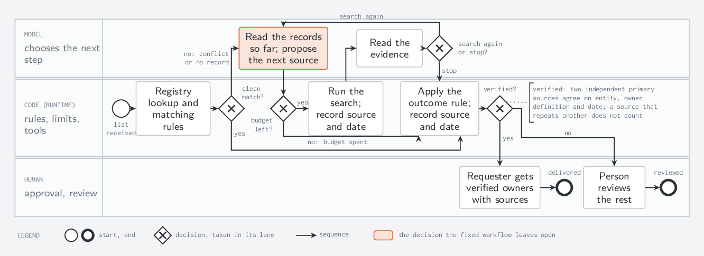

# bpmn-diagrams

A Claude Code skill that draws process diagrams for agentic systems in a small subset of BPMN 2.0, as TikZ for LaTeX documents.



## Why

An agent diagram usually hides the two things a reader needs to check: who decides each step, and where the limits are enforced. This skill makes both visible:

- **Three lanes:** the model (chooses the next step), the code (rules, limits, tools) and the person (approval, review). Every branch is a diamond in the lane of whoever decides it.
- **Every loop passes a cap in the code lane**, labelled with its limit ("budget left (of $2)?"). A cap written only in a label does not count.
- **One coral mark** shows the single decision the fixed workflow leaves to the model.
- **The diagram draws only what the sources say.** Where they are silent, the branch stops at its gateway with a note instead of an invented ending. A requirement table maps each source statement to the drawn elements and each element back to a statement, so additions and omissions show up.

The shapes keep their standard BPMN meanings (OMG BPMN 2.0.2), so a reader who knows BPMN can read the diagram, but nothing here is meant to run in a workflow engine.

## Install

As a plugin, from inside Claude Code:

```
/plugin marketplace add jibarix/bpmn-diagrams
/plugin install bpmn-diagrams@jibarix-bpmn-diagrams
```

Or copy `skills/bpmn-diagrams/` into `~/.claude/skills/` (all your projects) or a project's `.claude/skills/`. For Codex, copy it into `.agents/skills/`.

Claude loads the skill when you ask for a BPMN, swimlane or process-flow diagram of an agent or automated workflow, or you can run it as `/bpmn-diagrams:bpmn-diagrams` (plugin) or `/bpmn-diagrams` (copied folder).

## Requirements

- A LaTeX distribution with `pdflatex`, TikZ and the `inconsolata` font package. The examples also need `standalone` and `lmodern`. TeX Live and MiKTeX include all four.
- Ghostscript to render pages to PNG, so the model can look at its own drawing.

## What's inside

| Path | Contents |
|---|---|
| `skills/bpmn-diagrams/SKILL.md` | The twelve rules, the workflow (requirement table first, faithfulness check last) and the checklist for the report |
| `skills/bpmn-diagrams/references/bpmn_subset.md` | The shapes and their meanings, the reason for each rule, and the BPMN features left out |
| `skills/bpmn-diagrams/assets/bpmn_tikz.tex` | The TikZ styles, the lane and legend helpers, and a commented fragment to start from |
| `skills/bpmn-diagrams/examples/` | Three worked diagrams: a [phone agent](docs/phone_agent.png), an [investigation agent](docs/investigation_agent.png) and a [weekly planning run](docs/weekly_planning.png) with gap notes. Each compiles on its own from that folder |

## How well it works

I tested the skill on Claude Haiku in fresh, scripted runs, with and without the skill, and had the diagrams graded blind against answer keys written before any run. The test is small (three runs per arm per round), so read it as a smoke test:

- With the skill, the model followed the conventions much more often. For example, the coral mark on the model's one open decision appeared in 3 of 3 runs, and in 0 of 3 without the skill.
- The model did not reliably follow the step order. Even when the skill required the requirement table as a file before drawing, it was written first in only 1 of 3 runs. Where it was, that run was the only one that gave every cap its own gateway.
- On a dense one-page source, no run in either arm drew every requirement, and most runs added something the source did not say. The spread between runs was often larger than the difference between arms.

So the rules and the checklist help, but wording alone does not make a model follow them. For a diagram you publish, use the skill's last step: a fresh reviewer that sees only the sources, `requirements.md`, the `.tex` and the render, and checks the requirement table.

## License

MIT. See [LICENSE](LICENSE).

## Authorship and use of AI tools

J. A. Arroyo. Claude (Anthropic, through Claude Code) drafted the skill, the examples and this README under my direction. Codex (OpenAI) reviewed the rules, the test design and the skill's revisions. I set the rules and decided what to include.
